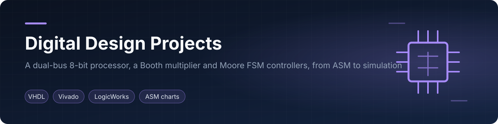

    

<a href="#english">English</a> · <a href="#español">Español</a>

## English

### Overview
Three register-transfer-level digital designs, each taken from specification to algorithmic state machine (ASM), datapath, control unit and simulation: a general-purpose 8-bit processor with a dual-bus datapath, a parameterizable signed Booth multiplier in VHDL, and a two-machine sequential controller for an LED pattern generator built from flip-flops and gates.

| Project | What it is | Tools |
|---|---|---|
| [`gp-processor-dual-bus`](gp-processor-dual-bus) | 8-bit, 16-instruction processor: dual unidirectional bus datapath, interrupt support, stack, 2 addressing modes, register-and-decoder control unit; programmed with a Booth multiplication routine | ASM charts, LogicWorks, VHDL (Vivado) |
| [`booth-multiplier-vhdl`](booth-multiplier-vhdl) | Signed multiplier (Booth) built from register arrays, an adder and a counter/multiplexer control unit; generic operand width | VHDL, Vivado simulator, LogicWorks |
| [`led-sequence-controller`](led-sequence-controller) | Moore sequence detector (12 states) driving a 5-state LED pattern controller, minimized by state partitions and implemented with JK flip-flops | Visual Automata Simulator, LogicWorks |

### Honest scope
These are design and simulation projects. Each project README states what is complete and what is a draft.

### Team & credits
Designed and written by Elías David Álvarez Martínez at Universidad Católica "Nuestra Señora de la Asunción" (Paraguay), 2023–2024. Reports and figures are shared for reference.

### License
MIT, see [LICENSE](LICENSE).

## Español

### Descripción
Tres diseños digitales a nivel de transferencia de registros, llevados desde la especificación hasta el diagrama ASM, la ruta de datos, la unidad de control y la simulación: un procesador de propósito general de 8 bits con ruta de datos de doble bus, un multiplicador de Booth con signo parametrizable en VHDL y un controlador secuencial de dos máquinas para un generador de patrones de LEDs con flip-flops y compuertas.

| Proyecto | Qué es | Herramientas |
|---|---|---|
| [`gp-processor-dual-bus`](gp-processor-dual-bus) | Procesador de 8 bits y 16 instrucciones: doble bus unidireccional, interrupciones, pila, 2 modos de direccionamiento, unidad de control con registro y decodificador; programado con una rutina de multiplicación de Booth | ASM, LogicWorks, VHDL (Vivado) |
| [`booth-multiplier-vhdl`](booth-multiplier-vhdl) | Multiplicador con signo (Booth) con arreglos de registros, un sumador y unidad de control con contador y multiplexor; ancho de operando genérico | VHDL, simulador de Vivado, LogicWorks |
| [`led-sequence-controller`](led-sequence-controller) | Detector de secuencias de Moore (12 estados) que gobierna un controlador de LEDs de 5 estados, minimizado por particiones y con flip-flops JK | Visual Automata Simulator, LogicWorks |

### Alcance
Son proyectos de diseño y simulación. Cada README indica qué está completo y qué es borrador.

### Equipo y créditos
Diseñado y redactado por Elías David Álvarez Martínez en la Universidad Católica "Nuestra Señora de la Asunción" (Paraguay), 2023–2024. Los informes y figuras se comparten como referencia.

### Licencia
MIT, ver [LICENSE](LICENSE).
