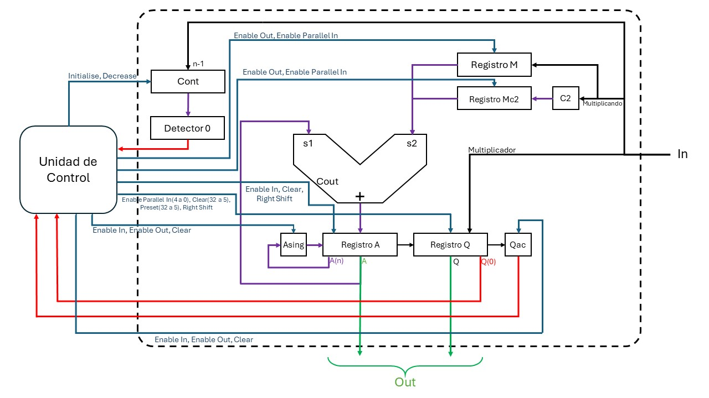
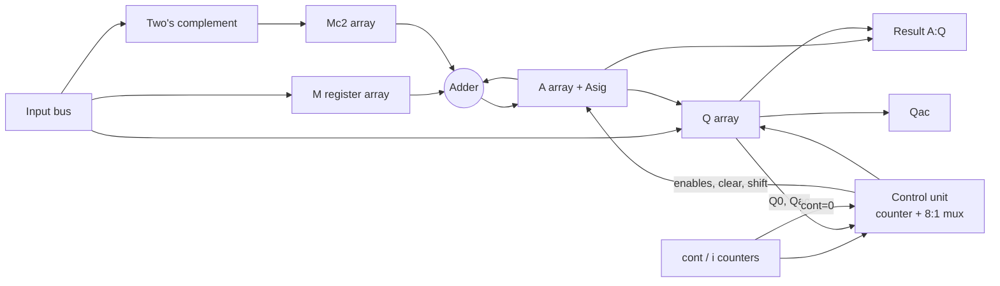
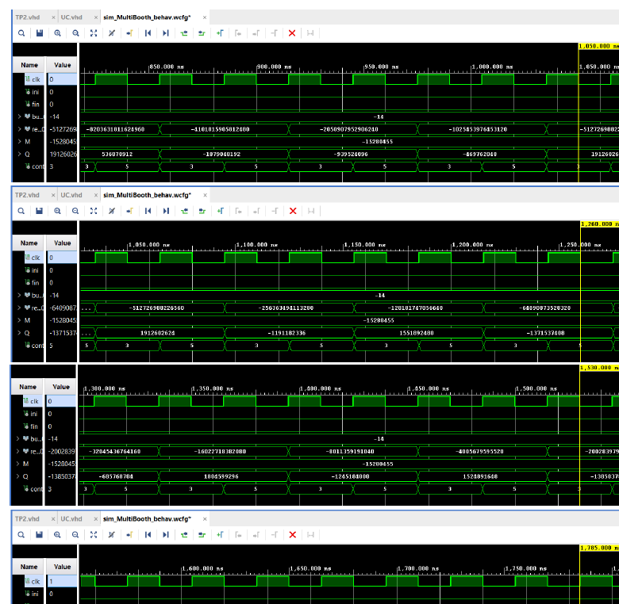
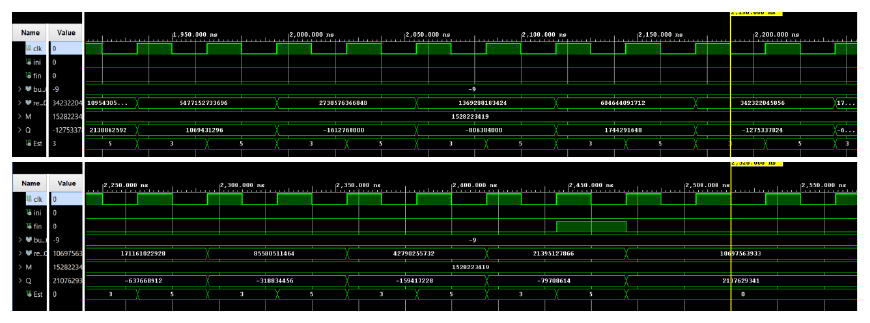

<p align="center"></p>
<h1 align="center">Signed Booth Multiplier in VHDL</h1>
<p align="center"><b>A parameterizable multiplier built as an ASM-driven datapath: register arrays, adder, shift chain and a counter/multiplexer control unit.</b><br>
   </p>
<p align="center"><a href="#english">English</a> · <a href="#español">Español</a></p>

## English

### Overview
A signed multiplier using Booth's algorithm. The design started as an algorithm, was turned into an ASM chart (states T0–T5), then into a datapath and a control unit, and finally into VHDL. Operands are loaded one register slice at a time from an input bus; `nReg` slices of `regLen = 8` bits give the operand width (`nReg = 4` gives 32-bit operands and a 64-bit result). The datapath evolved from a tri-state-buffer bus to multiplexers and decoders.

### Highlights
- ASM chart with an operand-load phase, a two's-complement phase (`Mc2 = not M + 1`), the Booth add/subtract-and-shift loop and a done flag.
- Generic top level (`MultiBooth`, generic `nReg`) with result width `2*nReg*regLen`.
- Datapath registers: `M`, `Mc2`, `Q`, `A`, sign flip-flop `Asig`, `Qac` (the bit shifted out of `Q`), carry flip-flop and an iteration counter.
- Control unit as a state counter plus an 8-input multiplexer that selects the condition (`Ini`, `i<nreg`, `i<nreg-1`, `Q0=Qac`, `cont=0`, `Q(0)`), described in VHDL (`hdl/UC.vhd`) and drawn in LogicWorks.
- Signal table listing every control signal per state (`docs/control-signals.xlsx`).

### System architecture


### Repository layout
```
hdl/            VHDL: top level (multi_booth.vhd), UC.vhd, register/mux/decoder/counter/comparator blocks, mi_paquete.vhd (types and adder function)
hdl/sim/        testbenches (multiplier, register blocks)
logicworks/     datapath.cct, control_unit.cct
docs/           control-unit.pdf, datapath-tiled.pdf, control-signals.xlsx, img/ (ASM chart, block diagram, waveforms)
```

### Getting started
Create a Vivado project, add everything in `hdl/` as design sources (compile `mi_paquete.vhd` first) and `hdl/sim/sim_multi_booth.vhd` as the simulation source; run a behavioral simulation. LogicWorks 5 opens the `.cct` files.

### Results
<p align="center"><br><sub>Behavioral simulation of the multiplier (operand M = -15280455 visible, state counter and Q register shifting).</sub></p>
<p align="center"><br><sub>Second run (M = 1528223419) ending with the <code>fin</code> pulse.</sub></p>

### Notes
`mi_paquete.vhd` is the package from the first iteration; later iterations reuse the same package name, but the exact copy used for the final waveforms was not in the source folder, so a clean compile has not been re-verified here. No board constraints or hardware tests were found.

### Team & credits
Designed and written by Elías David Álvarez Martínez, Universidad Católica "Nuestra Señora de la Asunción" (Paraguay), 2024.

### License
MIT.

## Español

### Descripción
Multiplicador con signo por el algoritmo de Booth. Se partió del algoritmo, se pasó a un diagrama ASM (estados T0–T5), luego a ruta de datos y unidad de control, y finalmente a VHDL. Los operandos se cargan por rebanadas de `regLen = 8` bits desde un bus de entrada; `nReg` rebanadas definen el ancho (`nReg = 4`: operandos de 32 bits y resultado de 64 bits). La ruta de datos evolucionó de un bus con buffers de tres estados a multiplexores y decodificadores.

### Puntos destacados
- ASM con fase de carga, fase de complemento a dos (`Mc2 = not M + 1`), lazo de suma/resta y desplazamiento de Booth, y bandera de fin.
- Entidad genérica `MultiBooth` (genérico `nReg`), resultado de `2*nReg*regLen` bits.
- Unidad de control con contador de estado y multiplexor de 8 entradas que selecciona la condición, en VHDL (`hdl/UC.vhd`) y en LogicWorks.
- Tabla de señales de control por estado (`docs/control-signals.xlsx`).

### Cómo usarlo
Crear un proyecto de Vivado, agregar `hdl/` como fuentes (compilar primero `mi_paquete.vhd`) y `hdl/sim/sim_multi_booth.vhd` como simulación. LogicWorks 5 abre los `.cct`.

### Notas
La copia exacta del paquete usada en las formas de onda finales no estaba en la carpeta fuente; no se re-verificó la compilación limpia. No hay restricciones de placa ni pruebas en hardware.

### Equipo y créditos
Diseñado y redactado por Elías David Álvarez Martínez, Universidad Católica "Nuestra Señora de la Asunción" (Paraguay), 2024.

### Licencia
MIT.
