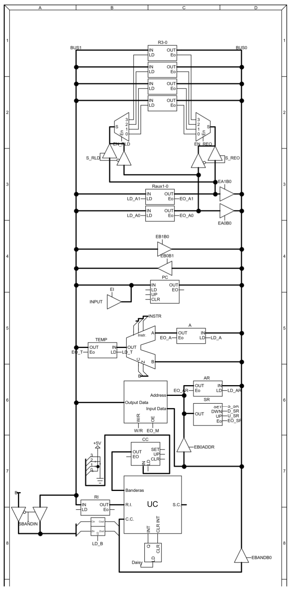
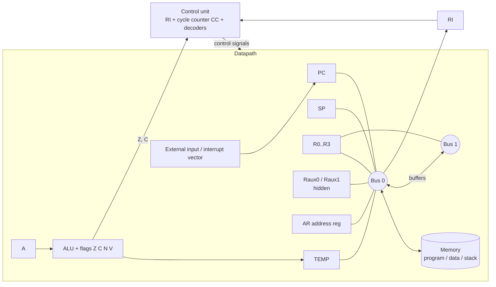

<p align="center"></p>
<h1 align="center">8-bit General-Purpose Processor with a Dual-Bus Datapath</h1>
<p align="center"><b>A 16-instruction, interrupt-capable processor designed from the ISA down to the control-unit signal table.</b><br>
   </p>
<p align="center"><a href="#english">English</a> · <a href="#español">Español</a></p>

## English

### Overview
An 8-bit processor with four general-purpose registers, a hardware stack, flags, interrupts and a two-bus (unidirectional) datapath. The instruction set was derived from a concrete workload: a signed multiplication by Booth's algorithm, written in the processor's own assembly (72 lines, see `docs/img/booth-program-listing.png`). The control unit follows the register-and-decoder method: the instruction register and a cycle counter feed decoders that select the active micro-operation, and invalid states reset the machine.

### Highlights
- 16 instructions in three groups (0, 1 and 2 operands) with a mode bit selecting register/immediate/indirect variants.
- Stack held in memory with a stack pointer, `CALL`/`RET`, `RETI`, and `PUSH`/`POP` of both registers and the flag register.
- Interrupt entry sequence in the fetch phase: PC and flags are pushed and PC is loaded from an external input.
- Two hidden auxiliary registers latch operands during fetch and enable indirect operations; buffer/decoder arrays route them to either bus.
- Complete ASM chart: fetch phase plus execution paths for 0, 1 and 2 operand instructions (cycles T0–T15).
- Control signal table covering every register, counter, memory, flag and bus-buffer enable per state.

### Instruction format
First byte: `b7-b6` operand count, `b5-b3` instruction, `b2` mode, `b1-b0` ALU selector. The following bytes hold destination/source 1 and source 2.

| Count | Opcode (`b7..b3`) | Instruction |
|---|---|---|
| 0 op | `00000` / `00001` / `00010` | `RET` / `RETI` / `PUSHB`-`POPB` (flag register) |
| 1 op | `01000` / `01001` / `01010` / `01011` | `NOT` / `JMP` / `BZ`-`BNZ` / `BC`-`BNC` |
| 1 op | `01100` / `01101` / `01110` | `PUSH`-`POP` / `SRLC`-`SRA` / `CALL` |
| 2 op | `10000` / `10001` / `10010` | `LD` / `ST` / `MOV` |
| 2 op | `10011` / `10100` / `10101` | `ADDR` / `ADDRI` / `AND` |

Opcodes are read from the ASM chart (`docs/asm-flowchart.pdf`); addressing-mode variants are in `docs/img/isa-opcode-table.png`. An unrecognized opcode sends the machine to an error state that restarts it.

### System architecture


### Repository layout
```
hdl/
  behavioral_model.vhd         state-machine model (fetch + part of the execute phase; several instruction branches are empty)
  structural_datapath_draft.vhd  structural datapath draft (registers, PC counter, buffers) - not a finished design
  dec2a4.vhd, dec3a8.vhd       decoder sources (dec3a8 is an unfinished draft)
logicworks/
  datapath.cct, control_unit.cct   LogicWorks schematics of the datapath and the control unit
docs/
  asm-flowchart.pdf, datapath.pdf, control-unit.pdf   vector diagrams
  img/                          datapath, ASM chart, control-unit diagram, ISA tables, Booth listing
```

### Getting started
Open the `.cct` files with LogicWorks 5 (datapath and control unit). The VHDL files can be added to a Vivado project for syntax checks and simulation; they are a model and drafts, not a synthesized core.

### Status
- Complete: ISA, instruction format, datapath, ASM chart, control-unit structure and signal table, Booth program.
- Design and simulation: the behavioral model covers reset, interrupt entry, fetch and part of the execute cycles; the structural description is a draft.

### Team & credits
Designed and written by Elías David Álvarez Martínez, Universidad Católica "Nuestra Señora de la Asunción" (Paraguay), 2024. The reference datapath template and the "register + decoder" control-unit requirement came from the supervising instructor.

### License
MIT.

## Español

### Descripción
Procesador de 8 bits con cuatro registros de propósito general, pila por hardware, banderas, interrupciones y ruta de datos de dos buses unidireccionales. El conjunto de instrucciones se derivó de una carga concreta: la multiplicación con signo por el algoritmo de Booth, escrita en el ensamblador propio (72 líneas, ver `docs/img/booth-program-listing.png`). La unidad de control usa el método de registro y decodificador: el registro de instrucción y un contador de ciclo alimentan decodificadores que seleccionan la microoperación activa; los estados inválidos reinician la máquina.

### Puntos destacados
- 16 instrucciones en tres grupos (0, 1 y 2 operandos) con un bit de modo para variantes registro/inmediato/indirecto.
- Pila con puntero, `CALL`/`RET`, `RETI` y `PUSH`/`POP` de registros y de banderas.
- Entrada de interrupción en la fase de búsqueda: se apilan PC y banderas y el PC se carga desde una entrada externa.
- Dos registros auxiliares ocultos guardan operandos durante la búsqueda y permiten operaciones indirectas.
- ASM completo: fase de búsqueda y ramas de ejecución para 0, 1 y 2 operandos (T0–T15).
- Tabla de señales de control por estado (registros, contadores, memoria, banderas y buffers de bus).

### Formato de instrucción
Primer byte: `b7-b6` cantidad de operandos, `b5-b3` instrucción, `b2` modo, `b1-b0` selector de ALU; los bytes siguientes contienen destino/fuente 1 y fuente 2. Los códigos de operación están en la tabla de la sección en inglés y en `docs/asm-flowchart.pdf`.

### Estado
- Completo: ISA, formato, ruta de datos, ASM, estructura y tabla de señales de la unidad de control, programa de Booth.
- Diseño y simulación: el modelo de comportamiento cubre reinicio, interrupción, búsqueda y parte de la ejecución; la descripción estructural es un borrador.

### Equipo y créditos
Diseñado y redactado por Elías David Álvarez Martínez, Universidad Católica "Nuestra Señora de la Asunción" (Paraguay), 2024. La ruta de datos de referencia y el requisito de unidad de control con registro y decodificador provienen del docente supervisor.

### Licencia
MIT.
