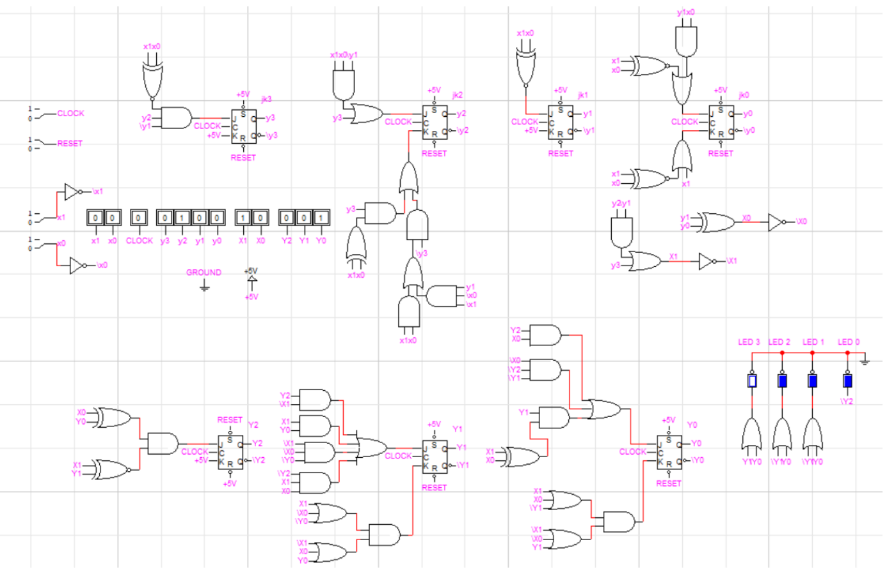
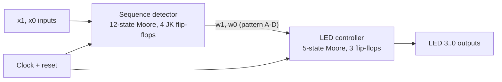
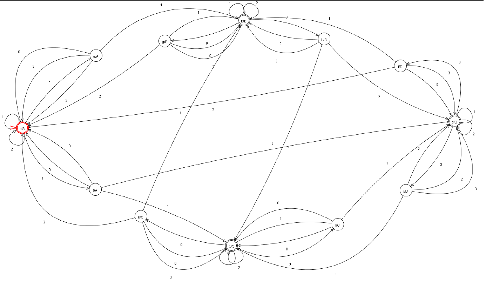
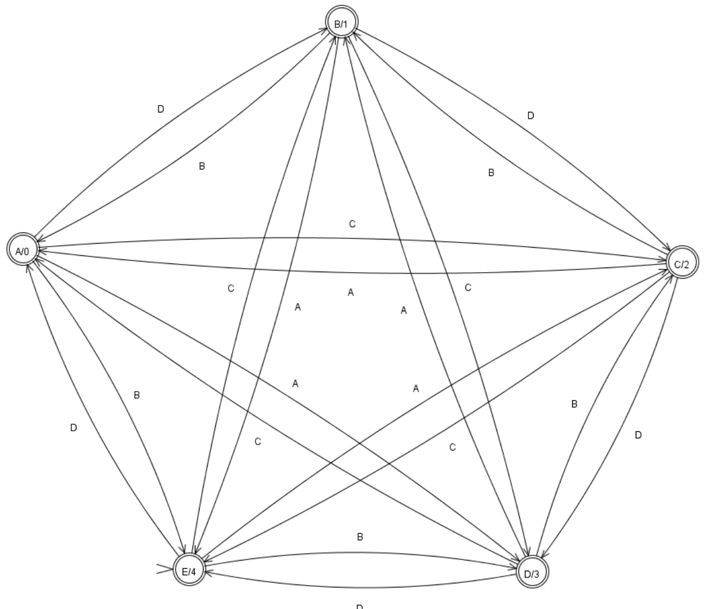
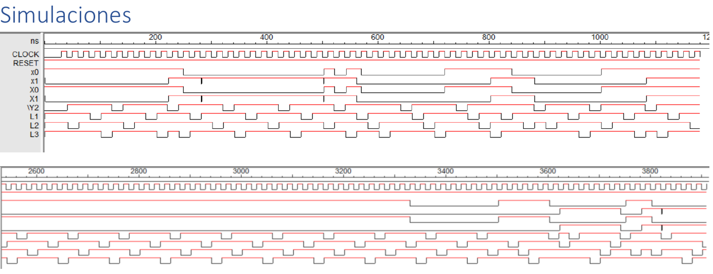

<p align="center"></p>
<h1 align="center">Sequence-Triggered LED Pattern Controller</h1>
<p align="center"><b>Two cascaded Moore machines, minimized by state partitions and built from JK flip-flops and gates.</b><br>
   </p>
<p align="center"><a href="#english">English</a> · <a href="#español">Español</a></p>

## English

### Overview
A four-LED light controller whose pattern is changed by short input sequences on two lines, `(x1, x0)`. The problem is split into two synchronous Moore machines: a **sequence detector** that validates input sequences (overlapping sequences accepted) and encodes the requested pattern as a 2-bit word `(w1, w0)`, and an **LED controller** that runs one of four rotating patterns in a loop depending on that word. Both were designed as automata, reduced with the implication table, encoded with state partitions, converted to JK-flip-flop equations with Karnaugh maps and simulated in LogicWorks.

### Highlights
- Detector: 12-state Moore machine with a 2-bit pattern output; no state equivalences, so no state reduction was possible. The 12 states fit in 4 flip-flops after merging two closed partitions (one bit saved versus the first encoding).
- LED controller: 5 states (all LEDs on, then LED 3 / 2 / 1 / 0 off) with 4-way transitions selected by the detector output; a closed partition did not exist, so a straightforward 3-bit encoding was used.
- Equations for each flip-flop input derived from Karnaugh maps; final circuit built with JK flip-flops and basic gates (74LS family datasheets referenced).
- Timing simulation shows the LED outputs rotating and the pattern changing after each valid input sequence.

### System architecture


### Repository layout
```
automata/     sequence-detector.fa, led-controller.fa   (Visual Automata Simulator)
logicworks/   controller.cct                              (complete circuit)
docs/img/     automata, state tables, circuit, simulation
```

### Getting started
Open the `.fa` files with Visual Automata Simulator and `controller.cct` with LogicWorks 5; use the clock, reset and the `x1`/`x0` switches to drive it.

### Results
<p align="center"><br><sub>Sequence-detector automaton.</sub></p>
<p align="center"><br><sub>LED-controller automaton and state table (A: all on; B-E: one LED off).</sub></p>
<p align="center"><br><sub>LogicWorks timing simulation: clock, reset, inputs and LED outputs.</sub></p>

### Team & credits
Designed and written by Elías David Álvarez Martínez, Universidad Católica "Nuestra Señora de la Asunción" (Paraguay), 2023. Simulation-only; no hardware build is documented.

### License
MIT.

## Español

### Descripción
Controlador de luces de cuatro LEDs cuyo patrón cambia con secuencias cortas en dos entradas `(x1, x0)`. Se dividió en dos máquinas de Moore síncronas: un **detector de secuencias** que valida las entradas (se aceptan secuencias solapadas) y codifica el patrón pedido en una palabra `(w1, w0)`, y un **controlador de LEDs** que ejecuta en bucle uno de cuatro patrones según esa palabra. Ambas se diseñaron como autómatas, se redujeron con tabla de implicación, se codificaron por particiones, se llevaron a ecuaciones con flip-flops JK mediante mapas de Karnaugh y se simularon en LogicWorks.

### Puntos destacados
- Detector de 12 estados sin equivalencias; al unir dos particiones cerradas se ahorra un bit de memoria.
- Controlador de 5 estados (todos encendidos y LED 3/2/1/0 apagado) con codificación directa de 3 bits.
- Circuito final con flip-flops JK y compuertas (hojas de datos de la familia 74LS).
- Simulación temporal con rotación de salidas y cambio de patrón tras cada secuencia válida.

### Equipo y créditos
Diseñado y redactado por Elías David Álvarez Martínez, Universidad Católica "Nuestra Señora de la Asunción" (Paraguay), 2023. Solo simulación; no se documenta construcción en hardware.

### Licencia
MIT.
